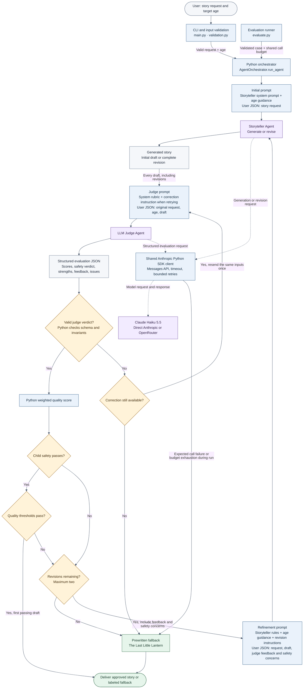

# Architecture

Solid arrows carry data or control. Dashed arrows show the model calls shared
by generation, judging, and refinement.

[Open the rendered SVG](system-flow.svg)

Blue blocks run in Python. Purple blocks invoke the model. Amber diamonds
are Python decisions. The judge reports a safety verdict and criterion
scores. Python validates the response, calculates the weighted quality score,
and requires both the child-safety gate and all quality thresholds to pass.
It accepts the first passing draft. A revised draft enters the same judge
path as the initial draft.

The CLI reprompts after invalid input and exits with a setup message if it
cannot initialize the client. During evaluation or an interactive story run,
expected model failures trigger the fallback after any eligible SDK retries.
If a completed judge reply fails validation, the judge resends the same
inputs with a trusted correction instruction. A second invalid verdict
triggers the fallback. The evaluation script reuses the same
orchestrator and stores score and execution metadata instead of story text.
See the [solution walkthrough](SOLUTION.md) for measured examples and the
exact release thresholds.
